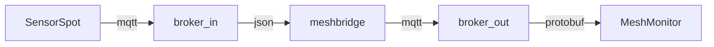

# meshbridge - Protocol bridge from sensors json to meshtastic protobuf

Проект предназначен для конвертации сигналов GNSS из json в протокол meshtastic посредством MQTT для дальнейшего отображения в self-hosted сервисах, работающих с протоколом мештастик

Например, на моем частном сервере есть инсталляция MeshMonitor, цель которой на единой карте отображать ноды Meshtastic и MeshCore, собирать связи между ними и выполнять некоторые автоматизации. 

В этом примере цель проекта - добавить к MeshMonitor еще один источник данных для отображения текущей локации ровера для удобного отображения текущего пути на общей карте с нодами тастика и кора в процессе вардрайвинга.

# Схема взаимодействия:

# Установка

to be filled...

# Ссылки

SensorSpot [GitHub](https://github.com/umercodez/SensorSpot)

MeshMonitor [Site](https://meshmonitor.org) * [GitHub](https://github.com/yeraze/meshmonitor)

