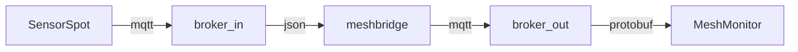
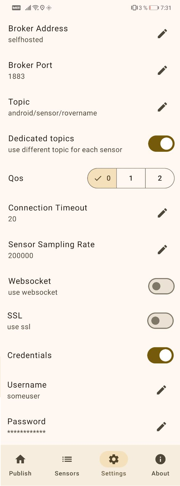
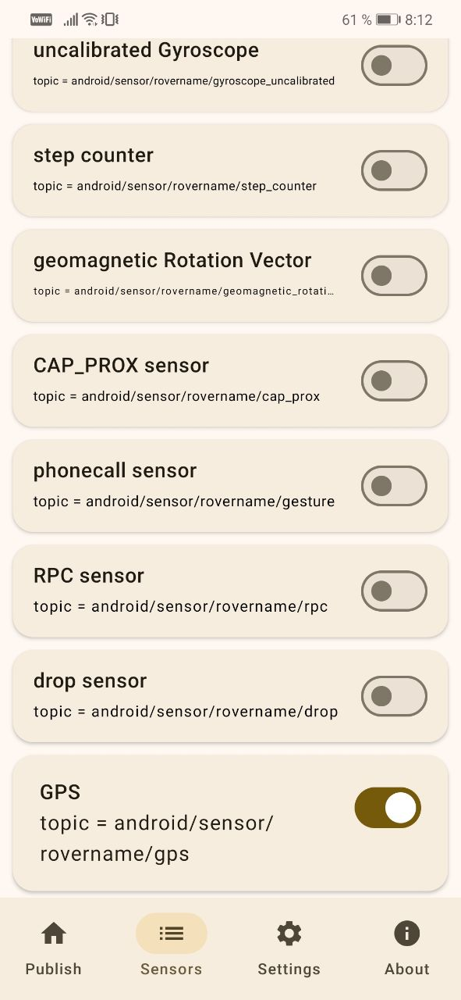
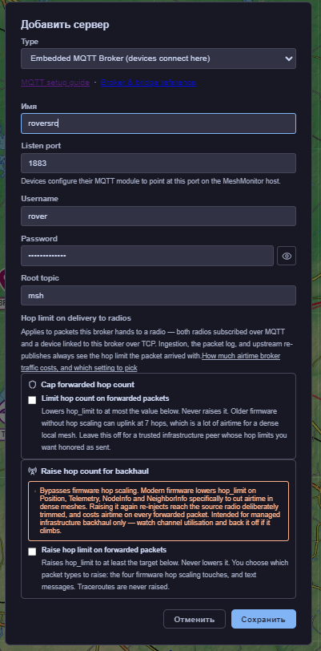

# meshbridge - Protocol bridge from sensors json to meshtastic protobuf

Проект предназначен для конвертации сигналов GNSS из json в протокол meshtastic посредством MQTT для дальнейшего отображения в self-hosted сервисах, работающих с протоколом мештастик

Например, на моем частном сервере есть инсталляция MeshMonitor, цель которой на единой карте отображать ноды Meshtastic и MeshCore, собирать связи между ними и выполнять некоторые автоматизации. 

В этом примере цель проекта - добавить к MeshMonitor еще один источник данных для отображения текущей локации ровера для удобного отображения текущего пути на общей карте с нодами тастика и кора в процессе вардрайвинга.


# Схема взаимодействия:



# Установка

## mqtt внешний (на примере mosquitto)

в файл /etc/mosquitto/passwd записываем креды
```
someuser:somepassword
```

создать файл /etc/mosquitto/conf.d/rover.conf для настройки параметров внешнего брокера

```ini
listener 1883 0.0.0.0
allow_anonymous false
password_file /etc/mosquitto/passwd
```


## docker compose

- Создаем папку 
- Скачиваем в нее docker-compose.yml из samples
- Редактируем под себя
- Раскаываем

```bash
docker compose up -d
```

# Настройка SensorSpot

## Настрйки



- Broker adress - ваш хост, досупный снаружи
- Broker port - порт внешнего брокера
- Topic = android/sensor/rovername - вместо rovername подставляем желаемое имя метки на карте
- Dedicated topics - должно быть включено
- Connection Timeout - выставляем в максимум 20 (секунд)
- Credentials - должно быть включено
- Username - логин к внешнему брокеру
- Password - пароль к внешнему брокеру

## Сенсоры



- на вкладке Sensors в самом низу включить GPS
- проверик topic

# Настройка исчточника в MeshMonitor



- добавить источник Embedded MQTT Broker
- имя - желаемое имя источника
- Username = rover - логин на внутреннний брокер 
- Password = roverpassword - пароль на внутрениий брокер
- Root topic - оставить msh

# Ссылки

SensorSpot [GitHub](https://github.com/umercodez/SensorSpot)

MeshMonitor [Site](https://meshmonitor.org) * [GitHub](https://github.com/yeraze/meshmonitor)

